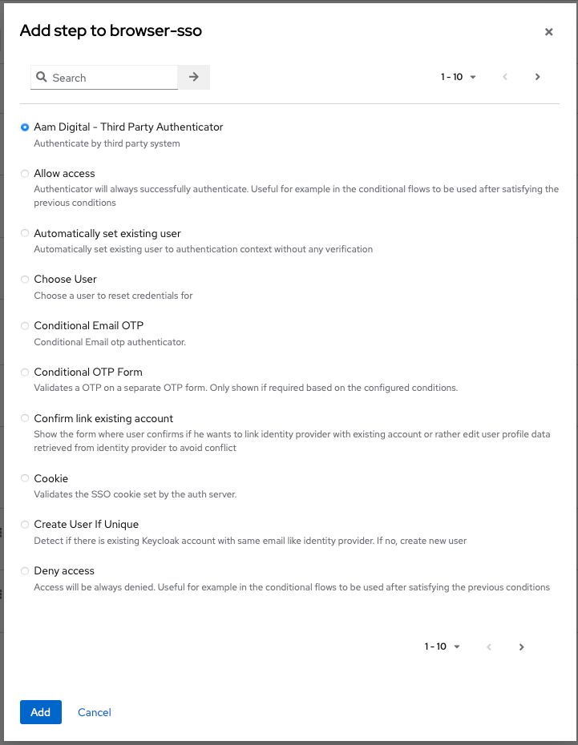
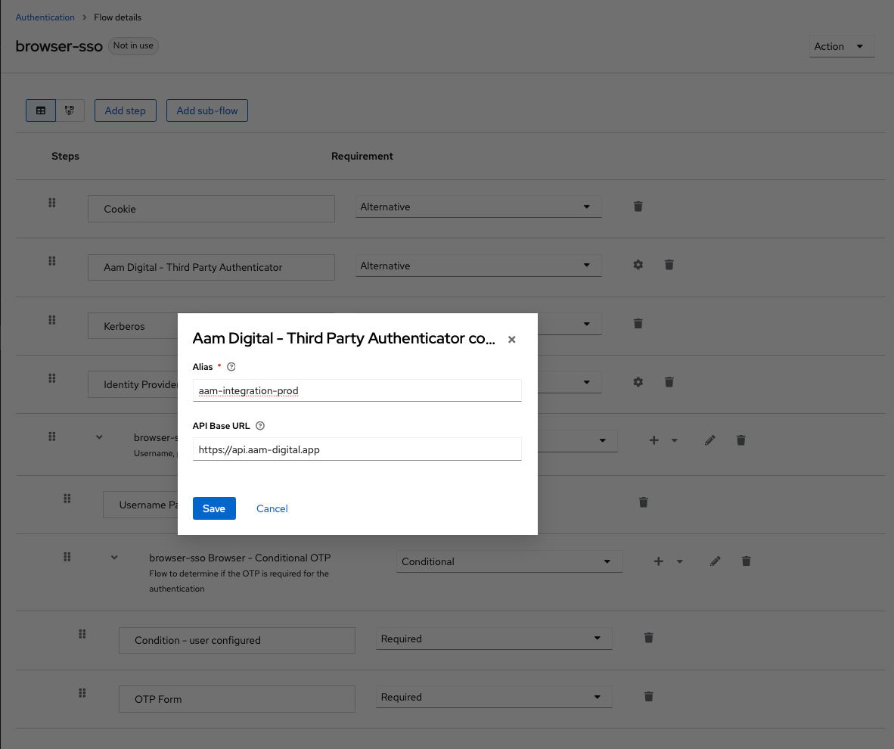

# Aam Digital - Third-Party Authentication / "Single-Sign-On" Integration
Allow another platform's users to log into Aam Digital with their (external) user accounts.
This enables a deeper integration with other systems like TolaData, as users only have to maintain one account.

## Overview
This flow enables other trusted authentication systems to sign-in users on their own.
For example:

- **System A:** Aam Digital system with a dedicated user database and authentication solution.
- **System B:** Other platform which is a partner for your system but also has a user database and an authentication solution.

1. User U1 from System B now wants to switch into your System A, but without sign-up or sign-in again. System B already identified the user U1.
2. System B creates a session on System A for the user U1 in the background (making an API request to the module described here).
3. User U1 is forwarded to the System A with a valid session identifier as payload.
4. The authentication solution from System A is validating the session information.
5. If necessary, System A automatically creates a new User U1 in the user database
6. System A signs in the user U1. The user does not have to enter a password on System A.

If there is already an account with the given email in Aam Digital, an access token is generated to log in as that existing user.

If no user with the given email exists, a new user is created in Aam Digital's Keycloak
and a new "User" entity is created in the CouchDB, linked to that Keycloak user.

### Dependencies
The Keycloak server requires a special Authenticator: [see keycloak-third-party-authentication](/application/keycloak-third-party-authentication/README.md)

### API Specification
_see [api-specs/third-party-authentication-api](../api-specs/third-party-authentication-api-v1.yaml)_

### Check if feature is enabled

You can make a request to the API to check if a certain feature is currently enabled and available:

```
> GET /actuator/features

// response:
{
  "third-party-authentication": { "enabled": true }
}
```

If the _aam-services backend_ is not deployed at all, such a request will usually return a HTTP 504 error.
You should also account for that possibility.


-----
## Setup
The backend module requires environment variables to access the Keycloak server:
```dotenv
FEATURES_THIRDPARTYAUTHENTICATION_ENABLED=true

KEYCLOAK_REALM=dummy-realm
KEYCLOAK_CLIENTID=aam-backend
KEYCLOAK_CLIENTSECRET=1234 # get this from the Keycloak client settings
KEYCLOAK_SERVERURL=https://keycloak.aam-digital.net

APPLICATION_BASEURL=dev.aam-digital.net # the base domain of the Aam Digital application to build redirect URLs
```

The backend uses its own Keycloak client (`aam-backend`) for admin access, which is different from the API client
of the external system. Import its definition, which ships with the backend
(see the [README of the definitions](../../application/aam-backend-service/keycloak/README.md)).

### Keycloak configuration
The Keycloak provider is [application/keycloak-third-party-authentication](../application/keycloak-third-party-authentication/),
included in the keycloak-aam image.

#### API client of the external system
The external system needs an API client with the client scope `third_party_authentication`; administrators create it
in the Aam Digital app ("API Access" in the admin section, see the [Admin module](admin.md)).
`POST /v1/third-party-authentication/session` rejects tokens without this scope with `403`.
The backend creates the client scope on startup (with the `realm-management` role `manage-clients`).

#### Login flow: the third-party authenticator
The realm's login flow (the flow bound as "Browser flow") needs the step `Aam Digital - Third Party Authenticator`
(provider `third-party-authenticator`, part of the keycloak-aam image) directly after the `Cookie` step.

- **The deployment adds the step, disabled.** ndb-setup's realm template has it in the `Email 2FA` login flow
  ([realm_config.json](https://github.com/Aam-Digital/ndb-setup/blob/master/keycloak/realm_config.json#L161-L167)),
  and its realm setup adds it to existing realms.
- **The backend switches it on.** When this module is enabled, the backend sets the step to `Alternative` on every
  startup and points it to its API (`<application.base-url>/api`). For that, the `aam-backend` service account
  needs the `realm-management` role `manage-realm` (granted by the
  [client definition](../../application/aam-backend-service/keycloak/aam-backend-client.json)).
  If the step is missing or Keycloak denies the change, the backend logs a warning and starts anyway.
  Disabling the module does not switch the step off again.

The step only acts on a login with a `tpa_session:…` hint (as the Aam Digital app sends it for a session created
through this API); any other login continues with the next step as usual.

Without the deployment's setup, add the step by hand in the Keycloak admin console:
1. Open the flow bound as "Browser flow" in the realm's `Authentication` settings (for realms from the current
   ndb-setup template: `Email 2FA`). Do **not** bind a copy of the default `browser` flow instead: that would
   drop the email 2FA of the realm.
2. `Add step` → `Aam Digital - Third Party Authenticator`, and move it directly after `Cookie`.

3. Set the requirement to `Alternative` and configure it (settings icon): any **Alias**, and the **API-Base Url**
   of the aam-services backend, e.g. `https://my-realm.aam.digital.app/api` (without API version or endpoint).
   The backend does both on its next start, if it has the `manage-realm` role.



### Aam Digital app & permissions setup
When a new account is created, that user does not have any roles assigned.
To give at least basic access (to see the app "Config" doc and therefore the UI), 
you should define the `"default"` role in your `Config:Permissions` configuration doc in the CouchDB and allow at least access to "Config".

-----
## Usage
You may use [Insomnia](https://insomnia.rest/) to test the API.
Basic API Requests are pre-defined for use: TODO

1. `POST /api/v1/third-party-authentication/session`
   - to create a new session for a user to log in without password
2. Redirect the user to the `entryPointUrl` returned in the response.
3. The user will be automatically authenticated
   1. Keycloak extracts the sessionId and sessionToken from the URL
   2. Keycloak validates the session with the Aam Digital API (`GET /api/v1/third-party-authentication/session/{sessionId}`)
      1. Aam Digital API finds the matching (via email) user in our system or creates a new Keycloak user
      2. Aam Digital API marks the session as used (invalidating it for future requests)
   3. Keycloak issues a valid session and JWT for the user
4. User is redirected to the Aam Digital application and ready to use it
